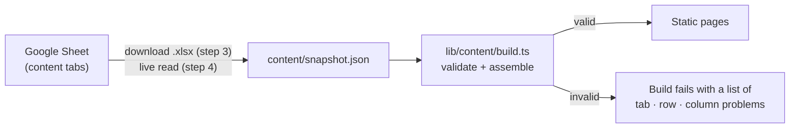

# Frontier Compass

A field guide to where to build next: arenas, problem cards and a builder-fit quiz.
Built with Next.js, deployed on Vercel. Content lives in a Google Sheet.

## How content flows



Validation runs on every build. A bad edit (unknown skill, typo in an archetype, ID turned into a
number, non-http link) stops the build and Vercel keeps serving the previous version.

## Updating content (until the live Sheet link is set up)

1. In Google Sheets: File → Download → Microsoft Excel (.xlsx).
2. `npm run snapshot -- ~/Downloads/frontier_compass_content.xlsx`
3. `npm run check:content` to see problems and warnings.
4. Commit `content/snapshot.json` and push. Vercel redeploys.

## Local development

```bash
npm install
npm run dev          # http://localhost:3000
npm run build        # production build, includes content validation
npm run typecheck
```

## Routes

| Path | Page |
|---|---|
| `/` | Cover |
| `/arenas` | Map of all arenas |
| `/arenas/[slug]` | Arena page, or coming-soon page. Filters live in the URL (`?cap=robotics&arch=Gap`). |
| `/cards/[id]` | Card dossier, e.g. `/cards/02-02` |
| `/fit` | Builder-profile quiz |
| `/shortlist` | Saved cards (this browser only for now) |

## Code map

- `lib/content/` types, spreadsheet validation (`build.ts`) and the loader (`index.ts`)
- `lib/match.ts` quiz scoring; weights and archetype leans come from the Sheet
- `lib/shortlist.ts` shortlist store (localStorage)
- `components/` UI; `app/` routes

## Roadmap

- [x] Step 3: port to Next.js with real routes, responsive, accessible, content validated
- [ ] Step 4: read the Google Sheet at build time (service account) + "Publish" menu in the Sheet
- [ ] Step 5: cohort access code, Supabase capture of quiz results and shortlist events
- [ ] Step 6: domain, privacy notice, pilot
