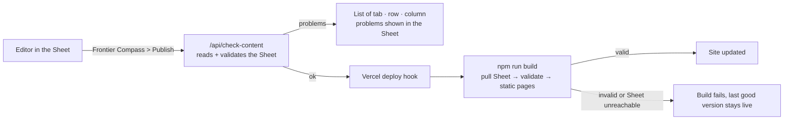

# Frontier Compass

A field guide to where to build next: arenas, problem cards and a builder-fit quiz.
Built with Next.js, deployed on Vercel. Content lives in a Google Sheet.

## How content flows



Validation runs twice: when you press Publish (so you see problems in the Sheet), and again in the build
(so nothing invalid can ever go live).

## Publishing content

In the Sheet: **Frontier Compass > Check content** to see problems, **Frontier Compass > Publish to site**
to publish. Publishing only happens if the check passes.

### One-time setup

| Where | What |
|---|---|
| Vercel → Settings → Environment Variables | `GOOGLE_SHEET_ID` (ID or full URL), `GOOGLE_SERVICE_ACCOUNT_KEY` (entire JSON key file), `CONTENT_CHECK_TOKEN` (random string, 24+ chars) |
| Vercel → Settings → Git → Deploy Hooks | Create a hook on branch `main`; copy its URL |
| Google Sheet → Share | Service account email as Viewer |
| Google Sheet → Extensions → Apps Script | Paste `apps-script/Publish.gs`, save, reload the Sheet, then Frontier Compass → Settings |

Without the two Google variables (e.g. local development) the build uses the committed `content/snapshot.json`.

## Local development

```bash
npm install
npm run dev            # http://localhost:3000
npm run build          # pulls the Sheet if configured, validates, builds
npm run check:content  # validate content/snapshot.json only
npm run pull           # refresh content/snapshot.json from the Sheet (needs the env vars in .env.local or the shell)
npm run snapshot -- file.xlsx   # or refresh it from a downloaded .xlsx
```

## Routes

| Path | Page |
|---|---|
| `/` | Cover |
| `/arenas` | Map of all arenas |
| `/arenas/[slug]` | Arena page, or coming-soon page. Filters live in the URL (`?cap=robotics&arch=Gap`). |
| `/cards/[id]` | Card dossier, e.g. `/cards/02-02` |
| `/fit` | Builder-profile quiz |
| `/shortlist` | Saved cards (this browser only for now) |
| `/api/check-content` | POST, `Authorization: Bearer $CONTENT_CHECK_TOKEN`. Validates the live Sheet. |

## Code map

- `lib/content/` types, spreadsheet validation (`build.ts`), Google Sheet reader (`sheets.ts`), loader (`index.ts`)
- `lib/match.ts` quiz scoring; weights and archetype leans come from the Sheet
- `lib/shortlist.ts` shortlist store (localStorage)
- `scripts/pull-sheet.ts` runs at the start of every build
- `apps-script/Publish.gs` the Sheet's Frontier Compass menu
- `components/` UI; `app/` routes

## Roadmap

- [x] Step 3: Next.js with real routes, responsive, accessible, content validated
- [x] Step 4: live Google Sheet + Check / Publish menu in the Sheet
- [ ] Step 5: cohort access code, Supabase capture of quiz results and shortlist events
- [ ] Step 6: domain, privacy notice, pilot
